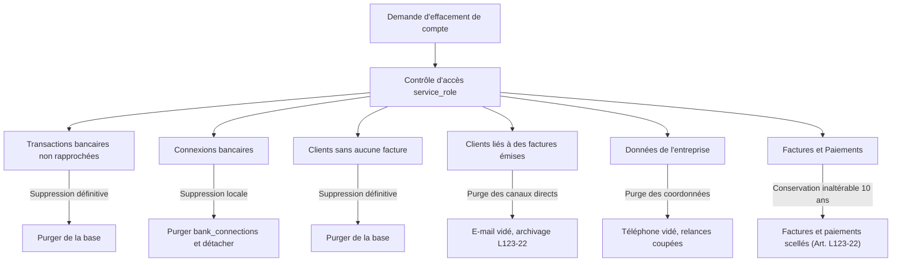

# Politique de Conservation et d'Anonymisation des Données Comptables (RGPD)

**Document de référence technique et réglementaire pour validation juridique**  
**Éditeur :** ARABACI HOLDING (SASU) / Bylz  
**Date :** Octobre 2026  

---

## 1. Contexte et articulation juridique (RGPD vs Obligations Légales)

L'article 17 du Règlement Général sur la Protection des Données (RGPD - Règlement UE 2016/679) consacre le droit à l'effacement (« droit à l'oubli »).  
Néanmoins, l'exercice de ce droit fait l'objet d'exceptions expresses prévues par l'**article 17 § 3 b) du RGPD**, qui dispose que le droit à l'effacement ne s'applique pas dès lors que le traitement est nécessaire :
> *« pour respecter une obligation légale qui requiert le traitement prévue par le droit de l'Union ou par le droit de l'État membre auquel le responsable du traitement est soumis »*.

En droit français, la tenue de la comptabilité et l'émission de factures soumettent les entreprises à des obligations d'archivage strictes d'ordre public :

1. **Code de commerce (Art. L. 123-22 alinéa 2) :**  
   *« Les documents comptables et les pièces justificatives sont conservés pendant dix ans. »*  
   Cette obligation couvre l'ensemble des factures de vente, des avoirs, des pièces justificatives d'encaissement et le livre chronologique des recettes.

2. **Livre des procédures fiscales (Art. L. 102 B) :**  
   Obligation de conservation pendant un délai minimal de **6 ans** à compter de la date de la dernière opération ou de l'établissement du document, applicable aux livres, registres et pièces justificatives sur lesquels s'exerce le droit de contrôle de l'administration fiscale.

3. **Code général des impôts (Art. 242 nonies A de l'annexe II et Art. 286 I 3° bis) :**  
   Obligation de faire figurer sur les factures les mentions légales obligatoires (dénomination du vendeur et de l'acheteur, adresses, numéros SIREN/SIRET, numéros de TVA) et obligation de garantir l'inaltérabilité, la sécurisation, la conservation et l'archivage séquentiel de tout enregistrement financier et de tout paiement.

4. **Code de commerce (Art. L. 441-9) :**  
   Sanctionne la délivrance ou la détention de factures ne comportant pas les mentions obligatoires.

Une suppression pure et simple des factures, de leurs mentions obligatoires ou des paiements à la demande d'un utilisateur placerait l'éditeur et l'utilisateur en infraction légale et fiscale.

---

## 2. Architecture mise en œuvre dans le code : Gel des mentions et Inaltérabilité

Pour concilier l'exercice du droit à l'effacement et le respect de ces obligations légales impératives, Bylz implémente une architecture d'inaltérabilité et de gel documentaire :

### A. Instantané légal figé à l'émission (`legal_snapshot`)
Dès qu'une facture quitte le statut de brouillon (`status <> 'draft'`), un trigger de base de données (`trg_freeze_invoice_legal_snapshot`) fige instantanément dans la colonne `legal_snapshot` :
- L'état exact du vendeur au moment de la facturation (raison sociale, nom commercial, SIRET, SIREN, adresse, régime de TVA, forme juridique).
- L'état exact de l'acheteur (nom, dénomination, type, SIREN, SIRET, adresse, numéro de TVA).
- Les lignes de prestation ou de vente, quantités, prix unitaires et montants.
- Les totaux HT, TVA et TTC calculés.

Le moteur de génération de documents PDF (`generate-pdf`) exploite prioritairement cet instantané figé. Ainsi, toute modification ultérieure sur la table `companies` ou `clients` ne peut en aucun cas altérer les mentions obligatoires des factures déjà émises.

### B. Verrouillage strict en base de données
Trois triggers interdisent toute altération des pièces comptables émises :
- `trg_invoice_immutability` : bloque toute mise à jour du numéro, de la date d'émission, de l'échéance, des montants HT/TVA/TTC, des identifiants d'entreprise ou de client, et du `legal_snapshot` sur toute facture émise. Seuls le statut de règlement (`pending`, `partially_paid`, `paid`, `late`) et les champs d'encaissement peuvent évoluer.
- `trg_invoice_no_delete` : interdit formellement la suppression (`DELETE`) de toute facture émise.
- `trg_payments_inalterabilite` : interdit formellement toute modification (`UPDATE`) ou suppression (`DELETE`) directe d'une ligne de paiement. Seule la contre-passation (`cancel_bank_transaction_match`) est autorisée.

---

## 3. Procédure d'Anonymisation RGPD (`delete_company_gdpr`)

La procédure `delete_company_gdpr(p_company_id uuid)` est une fonction interne `SECURITY DEFINER` strictement réservée au rôle d'administration système (`service_role`). Elle n'est reliée à aucune interface publique.

### Détail des opérations réellement exécutées :

| Donnée / Table | Traitement appliqué dans le code | Fondement juridique |
| :--- | :--- | :--- |
| **Authentification (`auth.users`)** | Compte banni définitivement (`banned_until`), e-mail pseudonymisé (`anonymized-<uuid>@rgpd.invalid`) | Interdiction de connexion et droit à l'effacement. |
| **Sessions actives (`auth.sessions`, `auth.refresh_tokens`)** | Sessions purgées et tokens révoqués | Invalidation immédiate de tout accès persistant. |
| **Profil utilisateur (`profiles`)** | E-mail pseudonymisé (`anonymized-<uuid>@rgpd.invalid`) | Droit à l'effacement (RGPD Art. 17). |
| **Entreprise (`companies`)** | Téléphone purgé, relances automatiques désactivées | Limitation du stockage des coordonnées de contact. |
| **Clients sans facture (`clients`)** | Suppression intégrale de la ligne | Donnée sans obligation légale de conservation (prospect). |
| **Clients avec factures (`clients`)** | E-mail de contact purgé, date `archived_at` horodatée | Les mentions légales restent scellées dans le `legal_snapshot` des factures. |
| **Transactions bancaires non rapprochées (`bank_transactions`)** | Suppression intégrale de la ligne | Non constitutives d'écritures comptables probatoires. |
| **Transactions bancaires rapprochées (`bank_transactions`)** | Libellé et contrepartie anonymisés, détachement bancaire (`bank_connection_id = NULL`), date et montant conservés | Traçabilité de l'encaissement et du livre des recettes (CGI Art. 286). |
| **Connexions bancaires (`bank_connections`)** | Suppression de la ligne en base de données | Fin de la synchronisation locale. |
| **Factures (`invoices`)** | Conservées sous statut scellé en lecture seule avec leur `legal_snapshot` | Obligation légale de conservation de 10 ans (Art. L123-22 Code de commerce). |
| **Paiements & Contre-passations (`payments`)** | Conservés intégralement sans aucune altération | Règle d'inaltérabilité comptable (Art. 286 du CGI). |

---

## 4. Ce qui n'est pas fait en base (actions externes requises)

La fonction SQL `delete_user_account_gdpr` opère au niveau de la base de données relationnelle. Conformément aux principes de transparence du RGPD, les éléments suivants ne sont pas traités par la procédure SQL et nécessitent des actions manuelles ou des fonctions d'orchestration externe (API tiers) :

1. **Révocation distante des accès bancaires chez les fournisseurs (Bridge, Enable Banking, GoCardless) :**
   La suppression de `bank_connections` en base coupe définitivement la synchronisation des données côté Bylz. En revanche, le consentement Open Banking enregistré auprès du fournisseur API ou de la banque de l'utilisateur n'est pas formellement révoqué par appel webhook. Il expire soit automatiquement à l'échéance légale DSP2 (90 à 180 jours), soit via une action manuelle de l'utilisateur dans l'application de sa banque.
2. **Client et abonnements Stripe :**
   Les objets `Customer`, `Subscription` et `PaymentMethod` hébergés sur les serveurs de Stripe ne sont pas supprimés automatiquement par la procédure SQL. Une clôture d'abonnement ou une demande d'anonymisation sur le tableau de bord Stripe reste nécessaire pour purger les cartes bancaires et mandats stockés chez le prestataire de paiement.
3. **Numéro et échanges WhatsApp (Meta Cloud API) :**
   Le numéro de téléphone associé à l'agent conversationnel WhatsApp n'est plus relié à aucun compte Bylz actif suite à la purge. Cependant, les historiques de messages stockés sur l'infrastructure Meta / WhatsApp Business Cloud API ne sont pas purgés par l'appel PostgreSQL.
4. **Abonnements push (WebPush) :**
   Les endpoints de notifications push enregistrés au niveau du navigateur de l'utilisateur doivent être désactivés par la suppression des autorisations dans le navigateur client ou lors du renouvellement des clés de diffusion.
5. **Fichiers dans le stockage objet (`storage.objects`) :**
   Les logos importés et les fichiers PDF générés stockés dans les compartiments (buckets) Supabase Storage ne sont pas détruits par la fonction SQL. Cette conservation permet de garantir l'intégrité probatoire des factures PDF déjà émises pendant le délai légal de 10 ans, tout en maintenant les fichiers hors d'accès public via les règles RLS de storage.

---

## 5. Mesures de sécurité et conservation probatoire

Pendant la durée d'archivage légale (10 ans) :
1. **Accès applicatif révoqué :** L'utilisateur dont le compte est anonymisé ne dispose plus de session active.
2. **Accès RLS étanche :** Les politiques de sécurité (Row Level Security) empêchent toute consultation croisée entre entreprises.
3. **Accès d'audit :** L'accès aux pièces comptables archivées est strictement restreint au rôle de service (`service_role`), mobilisable uniquement en cas de contrôle de l'administration fiscale, de l'URSSAF ou d'une autorité judiciaire.
4. **Purge post-délai légal :** Les pièces comptables et leurs instantanés sont conservés pour la durée légale de 10 ans prévue par l'article L. 123-22 du Code de commerce, après quoi ils pourront être purgés dans le cadre d'une procédure d'apurement d'archives.
